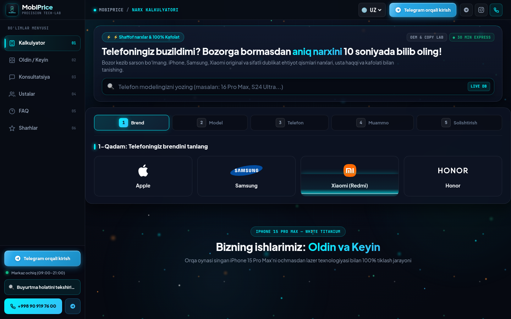
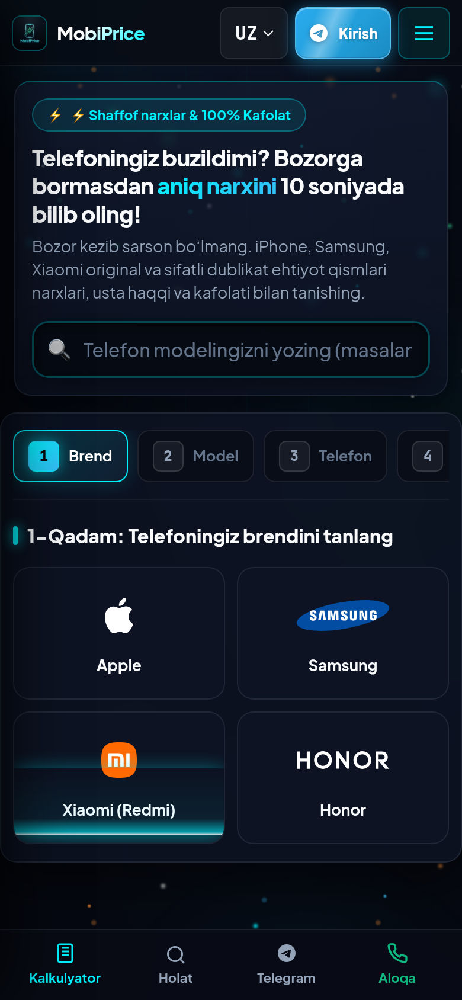

# MobiPrice — Smartfon Ehtiyot Qismlari va Servis Narxlari Platformasi

**MobiPrice** — smartfon ta'mirlash va ehtiyot qismlar (Original / OLED / Incell) narxlarini 10 soniyada aniqlash, buyurtma berish, buyurtma holatini kuzatish hamda **Telegram Bot (Mini-CRM + Kuryer lokatsiya tizimi)** orqali boshqarish uchun yaratilgan to'liq veb va bot platformasi.

---

## Ko'rinishi (Screenshots)

### Desktop ko'rinishi (5-qadamli narx kalkulyatori va katalog)


### Mobil ko'rinishi (390px responsiv dizayn)
<p align="center">
  
</p>

---

## Asosiy Imkoniyatlar

- **5-Qadamli Interaktiv Narx Kalkulyatori:** Brend → Model seriyasi → Aniq telefon → Muammo / Detal → Sifat va narxlarni solishtirish (`Original Service Pack`, `Original Donor`, `OLED GX/ZY`, `Incell/TFT`), kafolat, ombor qoldig'i va ta'mirlash vaqti bilan.
- **Jonli Qidiruv (Live Search):** Telefon modelini bir zumda topish.
- **3 Tilda (UZ / RU / EN):** Django i18n (`.po`/`.mo`) va dinamik API tarjimalari.
- **Xavfsiz Telegram Bot Autentifikatsiyasi (Faqat `+998`):**
  - Saytga kirish bir martalik deep-link token orqali Telegram botda amalga oshiriladi.
  - Bot faqat `ReplyKeyboard` (`request_contact=True`) tugmasi orqali yuborilgan o'zining **O'zbekiston (`+998`)** Telegram raqamini qabul qiladi (qo'lda kiritish, boshqa odam kontakti, vCard, forward va chet el raqamlari qat'iy rad etiladi).
- **2 Xil Buyurtma Formati:**
  1. **O'zim boraman (Servis markaziga):** Buyurtma tasdiqlangach servis manzili (`Malika bozor, B32 do'kon`) hamda to'g'ridan-to'g'ri **Google Maps** va **Yandex Maps** havolalari chiqadi.
  2. **Kuryer orqali olib ketish:** Mijoz Telegram botda hozirgi lokatsiyasini yuboradi → **OSRM** (yoki zaxira `Haversine × 1.25`) orqali aniq yo'l masofasi va kuryer narxi (`5 000 + km × 10 000 so'm`) hisoblanadi → mijozga yakuniy chek, menejerga lokatsiya pin + buyurtma kartasi yuboriladi.
- **Buyurtma Holatini Kuzatish (`#MP-XXXXXX`) va Mijoz Sharhlari:** Real vaqtda 4 bosqichli ta'mir statusi hamda 24 soatlik anti-spam himoyali sharhlar tizimi.
- **Telegram Admin & CRM Bot (`aiogram 3.x`):**
  - Rollar tizimi (RBAC): Superadmin, Sayt Administratori va Menejer.
  - Brend, seriya, telefon, muammo, narx va ustalarni to'liq bot orqali boshqarish (CRUD).
  - **Excel Import / Export** orqali narxlarni ommaviy yangilash.
  - **Mini-CRM:** Yangi arizalarni qabul qilish, ustaga biriktirish, holatni o'zgartirish va qidirish.
  - Har kuni `00:00` da avtomatik Gzip SQLite zaxira nusxasi (Backup).

---

## Texnologiyalar

- **Backend:** Python 3.12+, Django 5.2, SQLite
- **Telegram Bot:** `aiogram 3.x`, FSM (`MemoryStorage`), `asgiref`
- **Frontend:** Django Templates, Modular External CSS (Precision Tech-Lab UI), Vanilla JavaScript
- **Qo'shimcha:** `requests` (OSRM API), `openpyxl` (Excel), `Pillow`, `python-dotenv`

---

## Loyiha Tuzilishi

```text
MobiPrice/
├── config/                 # Django sozlamalari, URL va ASGI/WSGI
├── core/                   # Modellar, API viewlar, Telegram auth, masofa hisoblash, testlar
├── bot/                    # aiogram 3.x Telegram bot (client auth/courier, CRM, admin CRUD, Excel)
├── templates/              # HTML shablonlar va komponentlar
├── static/                 # Tashqi CSS, JS va tasvirlar
├── locale/                 # UZ / RU / EN tarjima fayllari (.po / .mo)
├── scripts/                # 30 ta SVG ikonka va cheatsheet generatori
├── docs/screenshots/       # README uchun skrinshotlar
├── Makefile                # Tezkor ishga tushirish buyruqlari
├── requirements.txt        # Python kutubxonalari
└── .env.example            # Muhit o'zgaruvchilari namunasi
```

---

## O'rnatish va Ishga Tushirish

1. **Repozitoriyni klonlash va virtual muhit yaratish:**
   ```bash
   git clone https://github.com/kadirkulovv/MobiPrice.git
   cd MobiPrice
   python3 -m venv .venv
   source .venv/bin/activate
   pip install -r requirements.txt
   ```

2. **`.env` faylini sozlash:**
   ```bash
   cp .env.example .env
   ```
   `.env` ichida `TELEGRAM_BOT_TOKEN`, `TELEGRAM_BOT_USERNAME` va `TELEGRAM_ADMIN_CHAT_ID` qiymatlarini kiriting.

3. **Migratsiyalarni qo'llash:**
   ```bash
   python3 manage.py migrate
   ```

4. **Veb-server va Telegram botni ishga tushirish:**
   ```bash
   # 1-terminal: Django server (http://127.0.0.1:8080)
   make run

   # 2-terminal: Telegram bot
   make bot
   ```

5. **Testlarni ishga tushirish:**
   ```bash
   python3 manage.py test core
   ```
